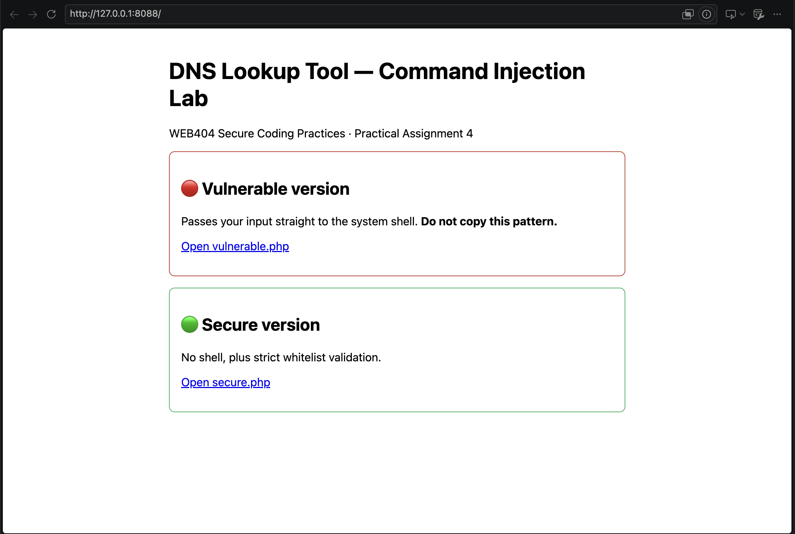
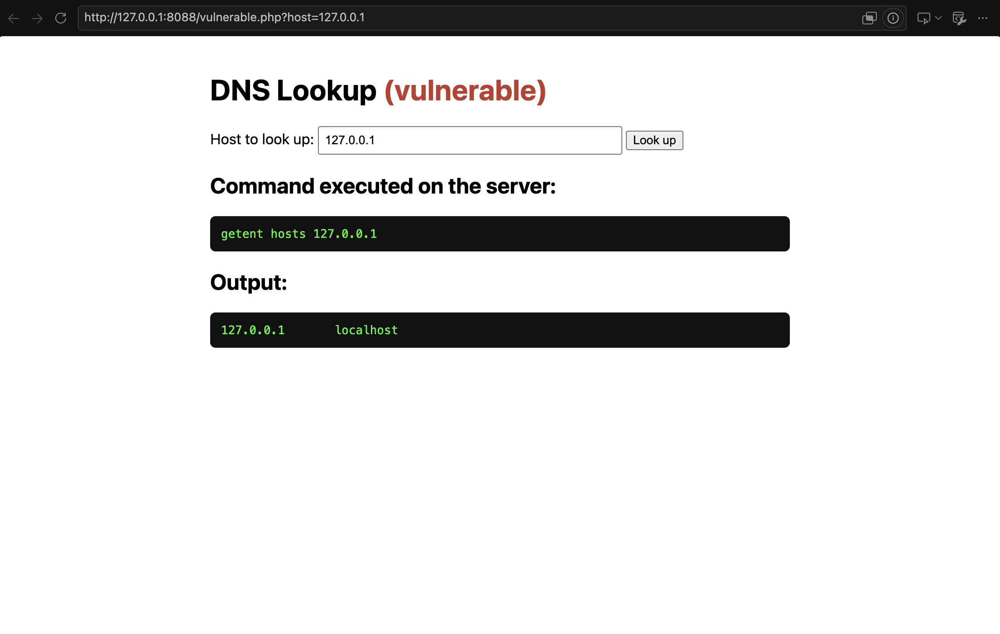
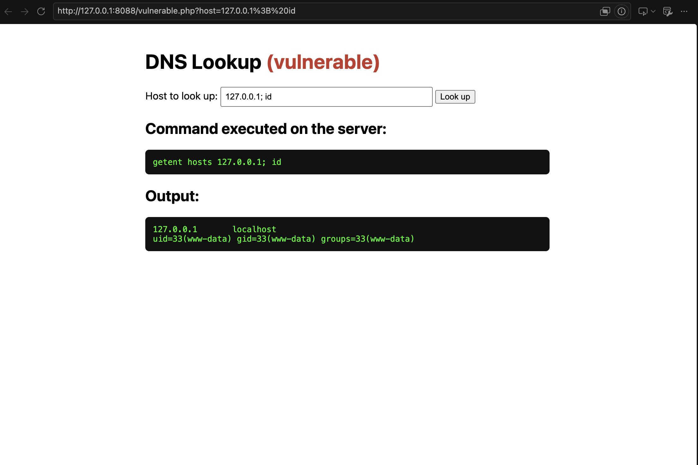
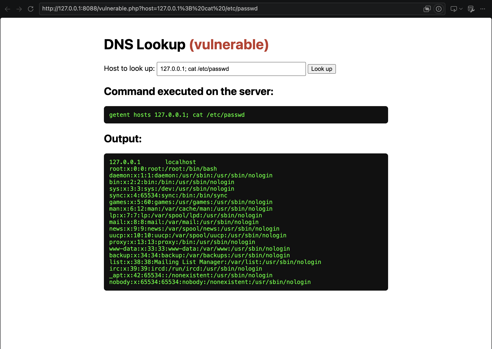
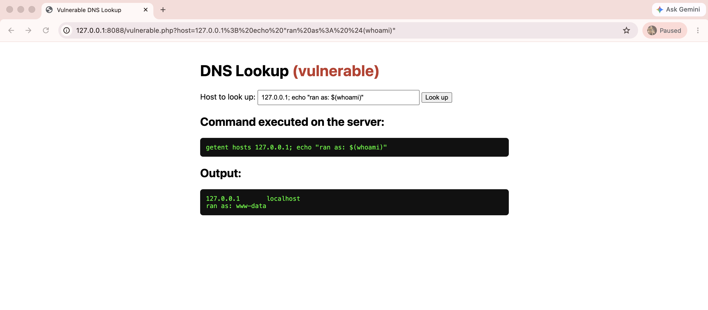
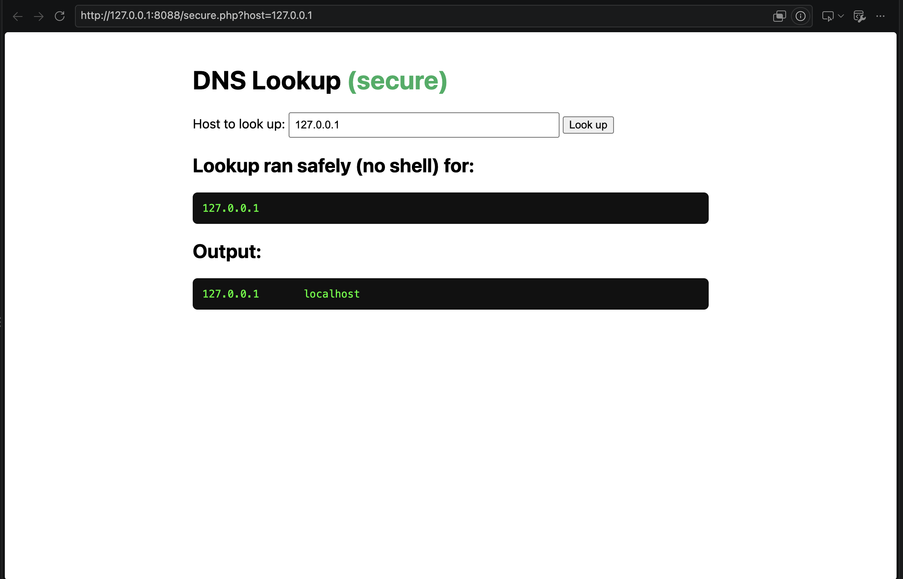
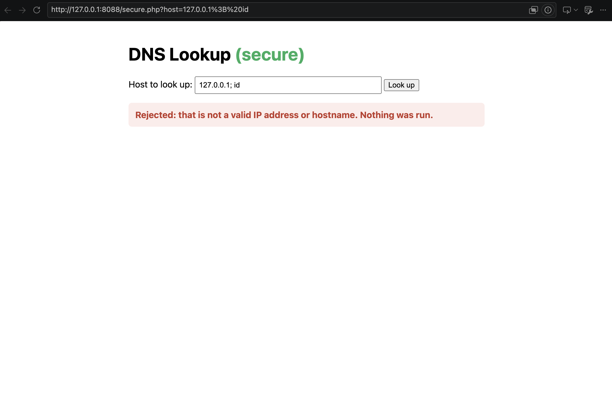
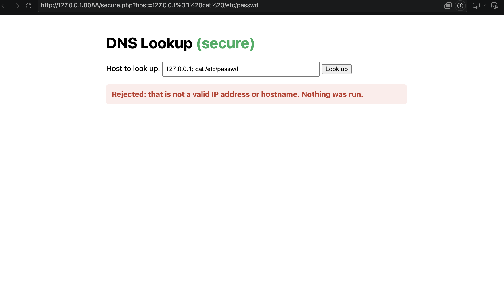
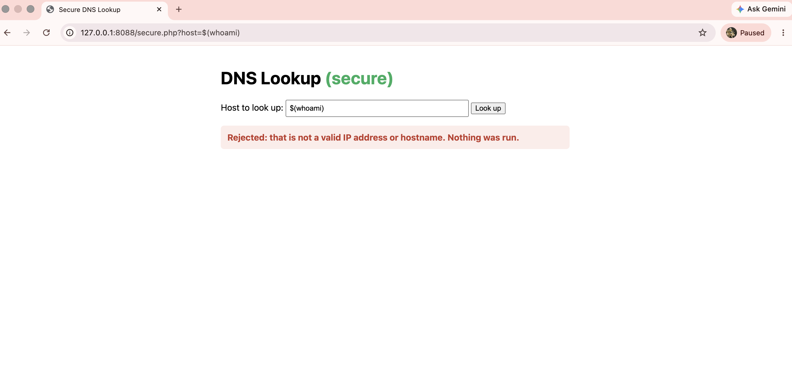

# WEB404 Practical Assignment 4: Command Injection

**Student ID:** 02230302
**Module:** WEB404, Secure Coding Practices
**Task:** Build a command-line tool in a web app, attack it with command injection, then fix it.

---

## 1. Key Ideas

**What the tool does.** It is a web page with one text box. You type a host
name or IP address (for example `127.0.0.1`), and the server tells you what
that address is called. To do this, the server runs a real Linux command:
`getent hosts <what you typed>`.

**What a shell is.** A shell (`/bin/sh`) is the program that reads a line of
text and runs it as commands, like the terminal. It gives some characters a
special meaning:

| Character | Meaning to the shell                          |
|-----------|-----------------------------------------------|
| `;`       | run the next command after this one           |
| `&&`      | run the next command if this one worked       |
| `\|\|`    | run the next command if this one failed       |
| `\|`      | send this output into the next command        |
| `$(...)`  | run the command inside first, use its output  |

**What command injection is.** If a web app puts what the user typed into a
command and gives it to the shell, the user can type these special characters
and add their **own** commands. The server then runs them. This is
**OWASP Top 10 2021, A03 Injection** and **CWE-78**.

**Why it is dangerous.** The attacker's commands run on the server with the
same rights as the web server. They can read private files, delete data, or
take over the machine.

---

## 2. Lab Setup

- **Docker** runs the whole lab in one isolated container (PHP 8.3 + Apache web server).
- The site is only open on `127.0.0.1:8088`, which means **this computer only**.
  Nobody on the network can reach the vulnerable page, and all tests target
  `127.0.0.1` / `localhost`, so no real system is attacked.

```bash
docker compose up -d     # start the lab, then open http://127.0.0.1:8088/
docker compose down      # stop the lab
```

| File                  | Purpose                      |
|-----------------------|------------------------------|
| `docker-compose.yml`  | container setup              |
| `src/index.php`       | landing page                 |
| `src/vulnerable.php`  | insecure version             |
| `src/secure.php`      | fixed version                |
| `screenshots/`        | evidence for each step       |

### Step 1: Open the lab



The landing page at `http://127.0.0.1:8088/`. It links to the vulnerable and
the secure version of the lookup tool.

---

## 3. The Vulnerable Version

```php
$host = $_GET['host'];               // whatever the user typed, unchecked
$cmd = "getent hosts " . $host;      // glued onto the command as text
$output = shell_exec($cmd . " 2>&1"); // the whole text is given to the shell
```

**The problem:** the user's text becomes part of the command. If the user
types `127.0.0.1; id`, the shell receives `getent hosts 127.0.0.1; id` and sees
**two** commands, so it runs both.

### Step 2: Normal use of the vulnerable page



Input `127.0.0.1` runs `getent hosts 127.0.0.1` and returns
`127.0.0.1  localhost`. The tool works as intended.

### Step 3: Attack with a command separator



Input `127.0.0.1; id`. The `;` makes the shell run `id` after the lookup. `id`
prints who the server is running as: `uid=33(www-data)`. `www-data` is the
user account of the web server. This proves an extra command ran on the server.

### Step 4: Read a sensitive file



Input `127.0.0.1; cat /etc/passwd`. `cat` prints a file, and `/etc/passwd` is
the list of every user account on the server. The page shows the whole file,
so the attacker can read files from the server.

### Step 5: Attack with command substitution



Input `127.0.0.1; echo "substitution ran as: $(whoami)"`. The shell runs
`whoami` inside `$(...)` first and puts the answer into the sentence, printing
`substitution ran as: www-data`.

The other characters work the same way: `127.0.0.1 && whoami`,
`doesnotexist || id` and `127.0.0.1 | id` all ran the extra command.

---

## 4. The Secure Version

Two separate fixes are used, so if one fails the other still protects the page.

### Fix 1: Do not use the shell

```php
$proc = proc_open(['getent', 'hosts', $host], $descriptors, $pipes);
```

The command is given as a **list** instead of one line of text. PHP starts
`getent` directly, with no shell in between. Nobody reads `;` or `$(...)` as
special, so `127.0.0.1; id` is treated as one strange host name that does not
exist. This alone stops the attack.

### Fix 2: Only accept valid input (whitelist)

```php
function is_valid_host(string $host): bool {
    if (filter_var($host, FILTER_VALIDATE_IP, FILTER_FLAG_IPV4)) {
        return true;   // a real IP address like 127.0.0.1
    }
    $pattern = '/^(?=.{1,253}$)[a-zA-Z0-9]([a-zA-Z0-9-]{0,61}[a-zA-Z0-9])?'
             . '(\.[a-zA-Z0-9]([a-zA-Z0-9-]{0,61}[a-zA-Z0-9])?)*$/';
    return (bool) preg_match($pattern, $host);   // a real host name
}
```

Before anything runs, the input must be a real IP address or a real host name
(only letters, numbers, dots and hyphens). Spaces, `;`, `|`, `&`, `$` and
brackets are not allowed, so every attack is rejected and nothing runs.

**Whitelist vs blacklist:** a blacklist tries to block every bad character, and
missing even one breaks it. A whitelist only lets through what is known to be
good and blocks everything else, so it is much safer.

**Least privilege:** the web server runs as `www-data`, not as `root` (the
admin account), so even a successful attack could do less damage.

### Step 6: Normal use of the secure page



Input `127.0.0.1` still returns `127.0.0.1  localhost`. The fix does not
break normal use.

### Step 7: Separator attack is blocked



Input `127.0.0.1; id` fails validation because `;` and the space are not
allowed. The page shows "Nothing was run." and no `id` output appears.

### Step 8: File read attack is blocked



Input `127.0.0.1; cat /etc/passwd` is rejected. Compare with Step 4: the file
is no longer shown.

### Step 9: Command substitution is blocked



The `$(whoami)` input is rejected because `$`, `(` and `)` are not valid in a
host name. Nothing runs.

---

## 5. Comparison

| Aspect            | Vulnerable                            | Secure                                  |
|-------------------|---------------------------------------|-----------------------------------------|
| How it runs       | `shell_exec("getent hosts " . $host)` | `proc_open(['getent','hosts',$host])`   |
| Uses a shell?     | Yes                                   | No                                      |
| Input checked?    | No                                    | Yes, whitelist                          |
| `127.0.0.1; id`   | Runs `id`                             | Rejected, nothing runs                  |

---

## 6. Conclusion

The vulnerable page joined user input into a shell command, so a normal text
box could run `id`, `whoami` and `cat /etc/passwd` on the server. The secure
page fixed this in two ways: it runs the program without a shell, and it only
accepts valid IP addresses or host names. The main lesson: **never build shell
commands from user input.**

---

## References

- OWASP Top 10:2021, A03 Injection: https://owasp.org/Top10/A03_2021-Injection/
- CWE-78, OS Command Injection: https://cwe.mitre.org/data/definitions/78.html
- OWASP OS Command Injection Defense Cheat Sheet: https://cheatsheetseries.owasp.org/cheatsheets/OS_Command_Injection_Defense_Cheat_Sheet.html
